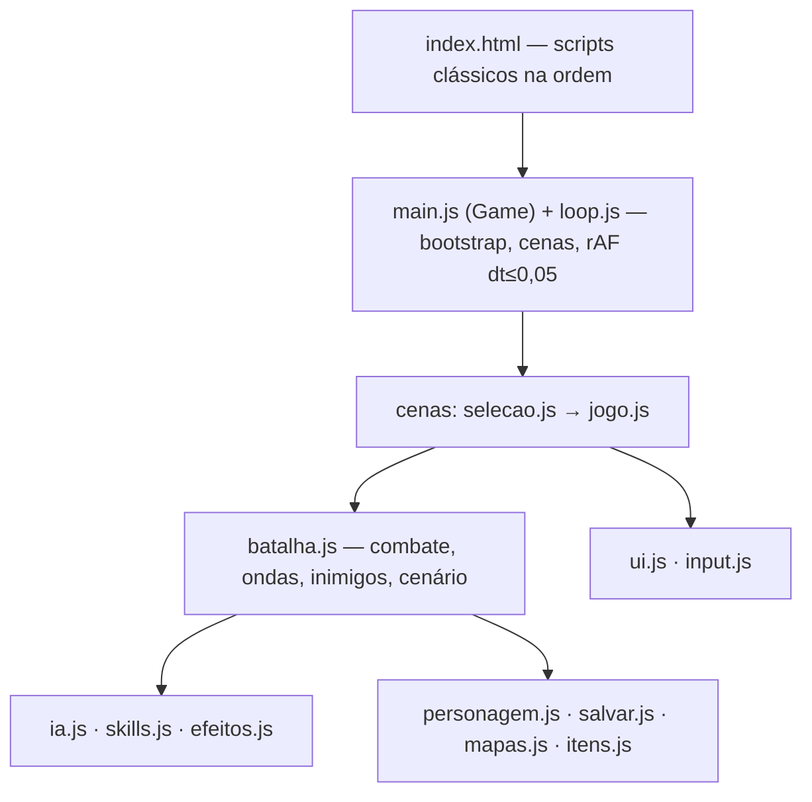

# Arquitetura

## Padrão de módulos
- Sem módulos ES: cada arquivo de `js/` expõe **um global via IIFE**
  (`var Foo = (function () { ... })();`) carregado por `<script>` clássico
  na ordem do `index.html` — dependências resolvem-se **pela posição**, não
  por imports (ex.: `ia.js` é carregado antes de `batalha.js`).
- Adicionar/renomear arquivo em `js/` exige atualizar o `index.html`;
  `testes/carga.js` lê a lista de scripts de lá e os testes acompanham.

## Cenas e loop
- Cena inicial `selecao` → `jogo`, com troca em `js/main.js` (`Game`,
  iniciado no `load` da janela). Loop em `js/loop.js`: `requestAnimationFrame`
  com `dt` limitado a 0,05s.
- Separação render/estado: desenho imediato por frame nas cenas/UI (botões
  agem pelo retorno de `UI.button`, exceto `+`/`−` de atributo em
  `Gestao.update`); o estado (personagem, save, batalha) vive nos globals.

## Centros de gravidade
- **`js/batalha.js`** (2233 linhas): cérebro do combate — herói mira/anda/
  ataca, ondas/XP/morte/revivescimento, inimigos, cenário
  (`garanteCenario`) e gatilhos das skills.
- **Dados**: `Personagem` (classes/níveis/status), `Salvar` (persistência),
  `Mapas` (temas/monstros/chefe), `Skills` (procs), `Itens` (drops/bolsa).
- **`js/ia.js`**: IA tática (avaliação utilitária + A*). **`js/efeitos.js`**:
  efeitos visuais das skills.

- O rasterizador de testes (`testes/cena.js`) limita as primitivas de
  desenho usáveis: só `fillRect`, `strokeRect` (+`strokeStyle`/`lineWidth`),
  `ellipse`+`fill`, `translate`/`scale`/`setTransform` e `globalAlpha`.
